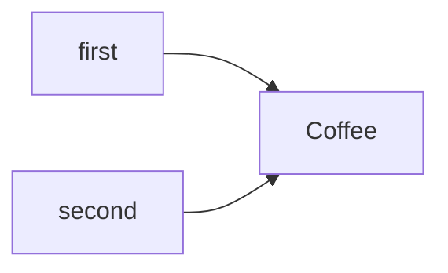
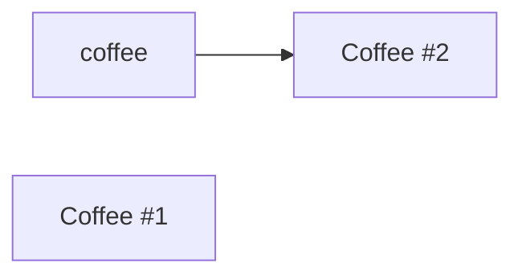
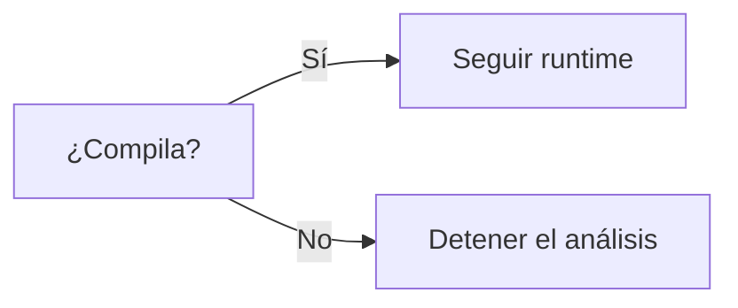
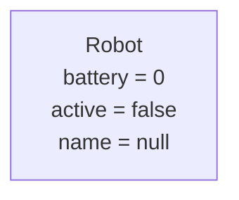
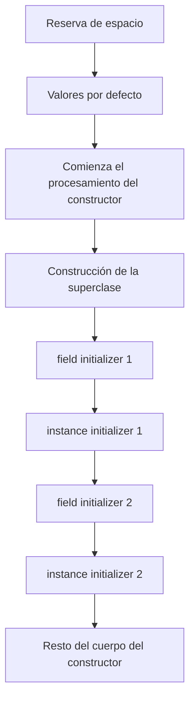
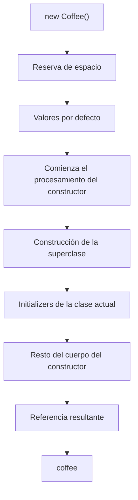

# Video 3 - Objetos, referencias y construcción

## Pregunta guía

¿Qué ocurre realmente cuando Java ejecuta `new MiClase()`?

## Objetivos

Al terminar este episodio deberíamos poder:

- distinguir una clase de una instancia creada en runtime;
- separar objeto, variable de referencia y valor de referencia;
- entender qué produce una expresión `new`;
- reconocer un constructor y diferenciarlo de un método;
- entender cuándo existe un constructor por defecto;
- identificar los valores iniciales de los fields de instancia;
- seguir el orden de field initializers e instance initializer blocks dentro del proceso de construcción;
- distinguir el comienzo del procesamiento del constructor del resto de su cuerpo;
- reconocer que la construcción de la superclase ocurre antes de los initializers de la clase actual;
- distinguir qué se resuelve en compile-time de qué sucede en runtime.

## Video

Este material acompaña al episodio **03 - Objetos, referencias y construcción** de la serie *Java 21 a Fondo*.

El enlace al video se agregará cuando el episodio sea publicado.

## Material

- [Experimentos](experiments/README.md)
- [Slides](slides/slides.md)
- [Cheat sheet](cheat-sheet/cheat-sheet.md)
- [Quiz](quiz/questions.md)
- [Ejemplos](examples/)

---

## 1. Una clase no es un objeto

Esta declaración define una clase:

```java
class Coffee {
}
```

Pero por sí sola no representa una instancia concreta creada por el programa.

Una expresión como:

```java
new Coffee();
```

es una **class instance creation expression**.

Cuando se evalúa, crea una nueva instancia y produce como valor una referencia al objeto creado.

Referencia oficial:

- [JLS 15.9 - Class Instance Creation Expressions](https://docs.oracle.com/javase/specs/jls/se21/html/jls-15.html#jls-15.9)
- [JLS 15.9.4 - Run-Time Evaluation of Class Instance Creation Expressions](https://docs.oracle.com/javase/specs/jls/se21/html/jls-15.html#jls-15.9.4)

---

## 2. Objeto y referencia no son lo mismo

```java
Coffee first = new Coffee();
Coffee second = first;
```

No se crean dos objetos.

Se crean dos variables de referencia que contienen valores que permiten acceder a la misma instancia.



Si modificamos el objeto mediante una referencia:

```java
first.temperature = 80;
```

y lo observamos mediante la otra:

```java
System.out.println(second.temperature);
```

vemos el mismo estado porque ambas referencias permiten acceder al mismo objeto.

Referencia oficial:

- [JLS 4.3 - Reference Types and Values](https://docs.oracle.com/javase/specs/jls/se21/html/jls-4.html#jls-4.3)

### Modelo conceptual

Durante la serie usaremos flechas para representar referencias:

```text
first -----> [ Coffee ]
```

La flecha es un modelo para razonar. No representa una dirección física observable garantizada por el lenguaje.

---

## 3. Reasignar una referencia

```java
Coffee coffee = new Coffee();
coffee = new Coffee();
```

La segunda asignación no transforma el primer objeto.

La variable `coffee` pasa a contener otra referencia.

Estado después de la reasignación:



En este episodio no analizamos todavía reachability ni garbage collection. Ese tema requiere primero comprender scope y ciclo de vida de variables.

---

## 4. Constructor no es método

Un constructor:

```java
class Coffee {
    Coffee() {
    }
}
```

tiene el mismo nombre que la clase y no declara return type.

En cambio:

```java
class Robot {
    void Robot() {
    }
}
```

declara un método llamado `Robot`.

No es un constructor.

Referencia oficial:

- [JLS 8.8 - Constructor Declarations](https://docs.oracle.com/javase/specs/jls/se21/html/jls-8.html#jls-8.8)

---

## 5. Constructor por defecto

Si una clase no declara constructores:

```java
class Coffee {
}
```

Java declara implícitamente un constructor por defecto.

Pero si declaramos uno:

```java
class Coffee {
    Coffee(int size) {
    }
}
```

esto ya no es válido:

```java
new Coffee(); // NO COMPILA
```

No existe un constructor sin argumentos aplicable.

Referencia oficial:

- [JLS 8.8.9 - Default Constructor](https://docs.oracle.com/javase/specs/jls/se21/html/jls-8.html#jls-8.8.9)

---

## 6. Compile-time antes que runtime

Antes de calcular una salida, conviene preguntar primero si el código compila.



Por ejemplo:

```java
class Coffee {
    Coffee(int size) {
        System.out.println("constructor");
    }
}

new Coffee(); // NO COMPILA
```

El `println` nunca llega a ejecutarse.

---

## 7. Los fields empiezan con valores definidos

Consideremos:

```java
class Robot {
    int battery;
    boolean active;
    String name;
}
```

Al crear una instancia, estos fields reciben valores iniciales:



Referencia oficial:

- [JLS 4.12.5 - Initial Values of Variables](https://docs.oracle.com/javase/specs/jls/se21/html/jls-4.html#jls-4.12.5)

---

## 8. Field initializers e instance initializer blocks

Podemos inicializar un field en su declaración:

```java
class Robot {
    int battery = 100;
}
```

El valor por defecto existe antes de evaluar ese initializer:

```text
battery = 0
     ↓
battery = 100
```

También podemos usar un instance initializer:

```java
class Robot {
    int battery = 100;

    {
        battery = 80;
    }
}
```

Los field initializers y los instance initializer blocks de la clase actual se ejecutan en el orden textual en que aparecen.

Referencia oficial:

- [JLS 8.6 - Instance Initializers](https://docs.oracle.com/javase/specs/jls/se21/html/jls-8.html#jls-8.6)
- [JLS 12.5 - Creation of New Class Instances](https://docs.oracle.com/javase/specs/jls/se21/html/jls-12.html#jls-12.5)

---

## 9. Orden de construcción

Consideremos una clase instrumentada:

```java
class Robot {

    String first = trace("field 1");

    {
        trace("initializer 1");
    }

    String second = trace("field 2");

    {
        trace("initializer 2");
    }

    Robot() {
        trace("constructor body");
    }

    static String trace(String value) {
        System.out.println(value);
        return value;
    }
}
```

Al ejecutar:

```java
new Robot();
```

observamos:

```text
field 1
initializer 1
field 2
initializer 2
constructor body
```

Esta salida muestra el orden observable de esas instrucciones.

No significa que el constructor recién sea invocado después de los initializers.

El modelo conceptual es:



Por tanto:

- los instance fields reciben primero sus valores por defecto;
- comienza el procesamiento del constructor seleccionado;
- se procesa la construcción de la superclase;
- los field initializers e instance initializer blocks de la clase actual se ejecutan en orden textual;
- después se ejecuta el resto del cuerpo del constructor de la clase actual.

En este episodio reconocemos que la construcción de la superclase forma parte del proceso, pero no desarrollamos todavía `this(...)`, `super(...)` ni constructor chaining.

Referencia oficial:

- [JLS 12.5 - Creation of New Class Instances](https://docs.oracle.com/javase/specs/jls/se21/html/jls-12.html#jls-12.5)
- [JLS 15.9.4 - Run-Time Evaluation of Class Instance Creation Expressions](https://docs.oracle.com/javase/specs/jls/se21/html/jls-15.html#jls-15.9.4)

---

## 10. Mapa completo

La expresión:

```java
Coffee coffee = new Coffee();
```

puede razonarse en dos etapas.

### Compile-time

El compilador debe determinar que la expresión es legal y que existe un constructor aplicable.

### Runtime



Una forma compacta de recordar las piezas es:

```text
clase
  ↓
expresión con new
  ↓
nueva instancia
  ↓
proceso de construcción
  ↓
referencia resultante
```

---

## OCP WATCH

- una variable de referencia no es el objeto;
- varias variables pueden referirse a la misma instancia;
- un método con el nombre de la clase y return type sigue siendo un método;
- el constructor por defecto solo aparece si la clase no declara constructores;
- los fields de instancia reciben valores iniciales;
- field initializers e instance initializer blocks de la clase actual siguen el orden textual;
- su ejecución ocurre antes del resto del cuerpo del constructor de la clase actual;
- la construcción de la superclase ocurre antes de los initializers de la clase actual;
- antes de razonar sobre runtime, comprobar si el código compila.

---

## Referencias oficiales

- [JLS 4.3 - Reference Types and Values](https://docs.oracle.com/javase/specs/jls/se21/html/jls-4.html#jls-4.3)
- [JLS 4.12.5 - Initial Values of Variables](https://docs.oracle.com/javase/specs/jls/se21/html/jls-4.html#jls-4.12.5)
- [JLS 8.6 - Instance Initializers](https://docs.oracle.com/javase/specs/jls/se21/html/jls-8.html#jls-8.6)
- [JLS 8.8 - Constructor Declarations](https://docs.oracle.com/javase/specs/jls/se21/html/jls-8.html#jls-8.8)
- [JLS 8.8.9 - Default Constructor](https://docs.oracle.com/javase/specs/jls/se21/html/jls-8.html#jls-8.8.9)
- [JLS 12.5 - Creation of New Class Instances](https://docs.oracle.com/javase/specs/jls/se21/html/jls-12.html#jls-12.5)
- [JLS 15.9 - Class Instance Creation Expressions](https://docs.oracle.com/javase/specs/jls/se21/html/jls-15.html#jls-15.9)
- [JLS 15.9.4 - Run-Time Evaluation of Class Instance Creation Expressions](https://docs.oracle.com/javase/specs/jls/se21/html/jls-15.html#jls-15.9.4)