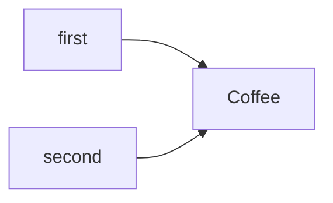
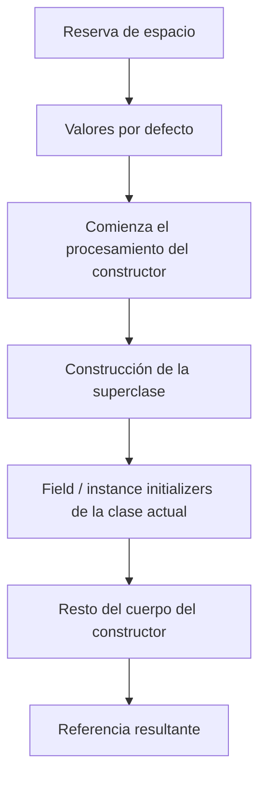
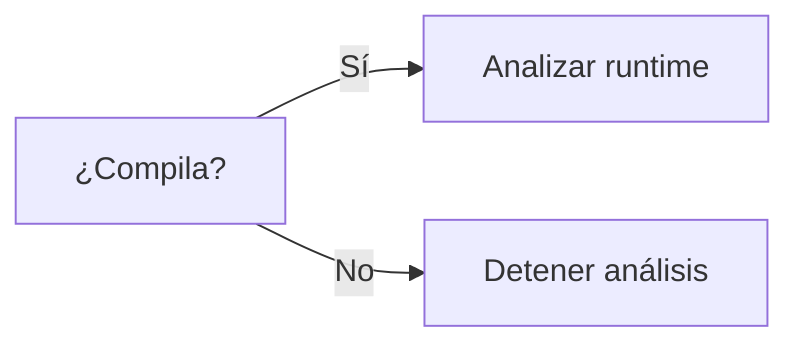

# Cheat sheet - Objetos, referencias y construcción

## Clase vs objeto

```java
class Coffee {
}
```

declara una clase.

```java
new Coffee();
```

crea una nueva instancia cuando la expresión se evalúa.

Referencia: JLS 15.9.

---

## `new` produce una referencia

```java
Coffee coffee = new Coffee();
```

Separación conceptual:

```text
Coffee          coffee          =        new Coffee();
  │                │                         │
tipo         variable/ref.             creación de instancia
```

La expresión `new Coffee()` produce una referencia al objeto creado.

---

## Dos referencias pueden referirse al mismo objeto

```java
Coffee first = new Coffee();
Coffee second = first;
```



Dos variables no implican dos objetos.

Referencia: JLS 4.3.

---

## Reasignación

```java
Coffee coffee = new Coffee();
coffee = new Coffee();
```

La variable cambia el valor de referencia que contiene.

No transforma el primer objeto.

---

## Constructor

```java
class Coffee {
    Coffee() {
    }
}
```

Un constructor:

- tiene el mismo nombre de la clase;
- no declara return type.

Un constructor **no es un método**.

Referencia: JLS 8.8.

---

## Falso constructor

```java
class Robot {
    void Robot() {
    }
}
```

`Robot()` es un método porque declara `void`.

---

## Constructor por defecto

Si una clase no declara ningún constructor, Java declara implícitamente un constructor por defecto.

```java
class Coffee {
}
```

Pero:

```java
class Coffee {
    Coffee(int size) {
    }
}
```

hace que:

```java
new Coffee(); // NO COMPILA
```

Referencia: JLS 8.8.9.

---

## Valores iniciales de fields

```java
class Robot {
    int battery;
    boolean active;
    String name;
}
```

Valores iniciales relevantes:

```text
battery = 0
active  = false
name    = null
```

Referencia: JLS 4.12.5.

---

## Field initializer

```java
class Robot {
    int battery = 100;
}
```

Modelo:

```text
battery = 0
     ↓
battery = 100
```

---

## Instance initializer

```java
class Robot {
    {
        System.out.println("initializer");
    }
}
```

Participa en la inicialización de cada instancia.

Referencia: JLS 8.6.

---

## Proceso de construcción

Modelo conceptual:



Los field initializers y los instance initializer blocks de la clase actual se ejecutan en orden textual.

Ese orden observable ocurre antes del resto del cuerpo del constructor de la clase actual.

No interpretar:

```text
initializers
    ↓
constructor
```

como si el constructor recién comenzara después de los initializers.

La construcción de la superclase ocurre antes de los initializers de la clase actual.

La cadena completa con `this(...)`, `super(...)` y constructor chaining se estudiará más adelante.

Referencias:

- JLS 12.5.
- JLS 15.9.4.

---

## Compile-time antes que runtime



Antes de calcular una salida, comprobar que existe un constructor aplicable y que el código compila.

---

## OCP WATCH

- variable de referencia != objeto;
- dos variables pueden referirse al mismo objeto;
- `void Robot()` es método, no constructor;
- el constructor por defecto solo aparece si no se declara ningún constructor;
- fields de instancia reciben valores iniciales;
- field e instance initializers de la clase actual siguen orden textual;
- esos initializers se ejecutan antes del resto del cuerpo de su constructor;
- la construcción de la superclase ocurre antes de los initializers de la clase actual;
- primero compile-time, después runtime.

---

## Referencias oficiales

- [JLS 4.3 - Reference Types and Values](https://docs.oracle.com/javase/specs/jls/se21/html/jls-4.html#jls-4.3)
- [JLS 4.12.5 - Initial Values of Variables](https://docs.oracle.com/javase/specs/jls/se21/html/jls-4.html#jls-4.12.5)
- [JLS 8.6 - Instance Initializers](https://docs.oracle.com/javase/specs/jls/se21/html/jls-8.html#jls-8.6)
- [JLS 8.8 - Constructor Declarations](https://docs.oracle.com/javase/specs/jls/se21/html/jls-8.html#jls-8.8)
- [JLS 8.8.9 - Default Constructor](https://docs.oracle.com/javase/specs/jls/se21/html/jls-8.html#jls-8.8.9)
- [JLS 12.5 - Creation of New Class Instances](https://docs.oracle.com/javase/specs/jls/se21/html/jls-12.html#jls-12.5)
- [JLS 15.9 - Class Instance Creation Expressions](https://docs.oracle.com/javase/specs/jls/se21/html/jls-15.html#jls-15.9)
- [JLS 15.9.4 - Run-Time Evaluation of Class Instance Creation Expressions](https://docs.oracle.com/javase/specs/jls/se21/html/jls-15.html#jls-15.9.4)
