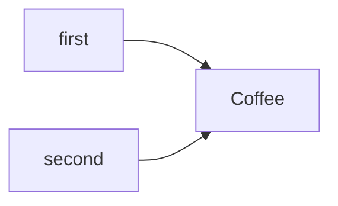
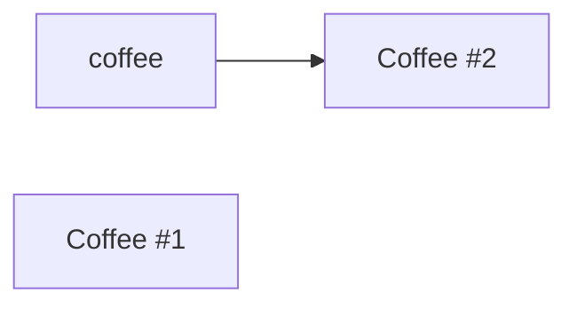
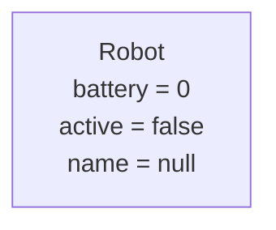
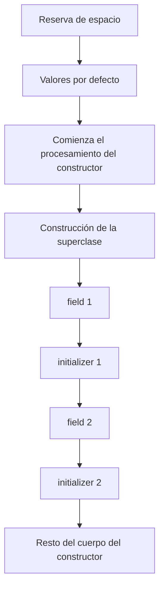
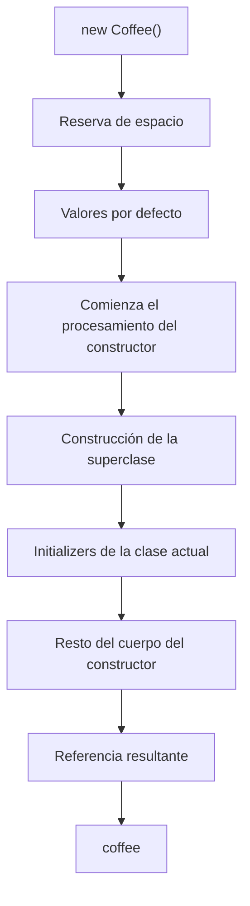

# Java 21 a fondo

## Objetos, referencias y construcción

### Episodio 03

¿Qué ocurre realmente cuando Java ejecuta `new Coffee()`?

---

## La pregunta del episodio

```java
Coffee coffee = new Coffee();
```

Aquí aparecen varias ideas distintas:

- tipo;
- variable;
- `new`;
- instancia;
- constructor;
- referencia.

**Separar las piezas cambia cómo razonamos Java.**

Referencia:

```text
JLS 15.9 - Class Instance Creation Expressions
```

---

## Una clase no es un objeto

```java
class Coffee {
}
```

declara un tipo.

```java
new Coffee();
```

crea una instancia cuando la expresión se evalúa en runtime.

Referencias:

```text
JLS 15.9
JLS 15.9.4
```

---

## Crear no exige guardar la referencia

```java
public static void main(String[] args) {
    new Coffee();
}
```

La expresión se evalúa aunque ninguna variable conserve el valor producido.

**crear objeto != guardar referencia**

Referencia:

```text
JLS 15.9.4 - Run-Time Evaluation
```

---

## Desmontemos la línea

```java
Coffee coffee = new Coffee();
```

```text
Coffee          coffee          =        new Coffee();
  │                │                         │
tipo           variable                  creación
```

La parte derecha produce una referencia.

La variable puede almacenarla.

Referencias:

```text
JLS 4.3
JLS 15.9
```

---

## Objeto y referencia tampoco son lo mismo

```java
Coffee first = new Coffee();
Coffee second = first;
```



**2 variables, 1 instancia.**

Referencia:

```text
JLS 4.3 - Reference Types and Values
```

---

## Dos referencias, un mismo estado

```java
first.temperature = 80;
System.out.println(second.temperature);
```

Resultado:

```text
80
```

No se copió el objeto.

Se copió la referencia.

---

## OCP WATCH - ¿Cuántos objetos hay?

```java
Coffee a = new Coffee();
Coffee b = a;
Coffee c = new Coffee();
```

```text
3 variables de referencia
2 objetos
```

En ejercicios simples, mira qué expresiones de creación se evalúan.

---

## La flecha es un modelo conceptual

```text
coffee --------> [ Coffee ]
```

La flecha representa conceptualmente un valor de referencia.

No afirmamos una dirección física observable ni una representación particular de la JVM.

Referencia:

```text
JLS 4.3 - Reference Types and Values
```

---

## Reasignar una referencia

```java
Coffee coffee = new Coffee();
coffee = new Coffee();
```



La variable cambia de referencia.

El primer objeto no se transforma en el segundo.

**GC: todavía no.**

---

## Constructor != método

```java
class Coffee {
    Coffee() {
        System.out.println("constructor");
    }
}
```

Un constructor:

- tiene el mismo nombre de la clase;
- no declara return type.

La JLS trata constructores y métodos como categorías distintas.

Referencia:

```text
JLS 8.8 - Constructor Declarations
```

---

## El constructor que era un método

```java
class Robot {
    void Robot() {
        System.out.println("method");
    }
}
```

```java
new Robot();
```

no imprime `method`.

```java
robot.Robot();
```

sí invoca el método.

Referencia:

```text
JLS 8.8
```

---

## Constructor por defecto

```java
class Coffee {
}
```

Java declara implícitamente un constructor por defecto.

Pero:

```java
class Coffee {
    Coffee(int size) {
    }
}
```

hace que:

```java
new Coffee(); // NO COMPILA
```

Si la clase declara algún constructor, ya no se declara implícitamente el default constructor.

Referencia:

```text
JLS 8.8.9 - Default Constructor
```

---

## Compile-time antes que runtime

```text
COMPILE-TIME
¿es legal?
¿hay constructor aplicable?

        ↓ solo si compila

RUNTIME
salida
valores finales
orden de ejecución
```

Si no compila, no llegamos a runtime.

Referencia:

```text
JLS 15.9
```

---

## Un objeto ya comienza con estado

```java
class Robot {
    int battery;
    boolean active;
    String name;
}
```



Los fields de instancia reciben valores iniciales por defecto.

Referencia:

```text
JLS 4.12.5 - Initial Values of Variables
```

---

## Field initializer

```java
class Robot {
    int battery = 100;
}
```

```text
battery = 0
     ↓
battery = 100
```

Primero existe el valor por defecto.

Después se evalúa el initializer.

Referencias:

```text
JLS 4.12.5
JLS 12.5
```

---

## Instance initializer block

```java
class Robot {
    int battery = 100;

    {
        battery = 80;
    }
}
```

```text
battery = 100
      ↓
battery = 80
```

Está en el class body.

No es un member.

Referencia:

```text
JLS 8.6 - Instance Initializers
```

---

## Orden observable de inicialización

```java
class Robot {

    String first = trace("field 1");

    {
        trace("initializer 1");
    }

    String second = trace("field 2");

    {
        trace("initializer 2");
    }

    Robot() {
        trace("constructor body");
    }
}
```

Salida:

```text
field 1
initializer 1
field 2
initializer 2
constructor body
```

Los field initializers y los instance initializer blocks de la clase actual se ejecutan en orden textual.

---

## Lo que vemos no es todo el proceso

La salida anterior muestra:

```text
field 1
initializer 1
field 2
initializer 2
constructor body
```

Pero eso representa el orden observable de esas instrucciones.

No significa:

```text
initializers
    ↓
constructor
```

como orden completo del proceso de construcción.

---

## Proceso de construcción



Referencias:

```text
JLS 8.6
JLS 12.5
JLS 15.9.4
```

---

## PRECISIÓN - modelo acotado

La construcción de la superclase ocurre antes de los initializers de la clase actual.

En este episodio no desarrollamos todavía:

- `this(...)`;
- `super(...)`;
- constructor chaining.

Eso llegará cuando estudiemos diseño de clases.

Referencia:

```text
JLS 12.5 - Creation of New Class Instances
```

---

## Volvamos a la línea completa

```java
Coffee coffee = new Coffee();
```

### Compile-time

```text
Coffee coffee = new Coffee();
                    │
                    └─ constructor aplicable
```

### Runtime

```text
new Coffee()
     │
     ├─ reserva espacio
     ├─ valores por defecto
     ├─ comienza el procesamiento del constructor
     ├─ construcción de la superclase
     ├─ initializers de la clase actual
     ├─ resto del cuerpo del constructor
     └─ produce una referencia
            │
            ▼
coffee ──► [ Coffee ]
```

Referencias:

```text
JLS 4.3
JLS 8.6
JLS 8.8
JLS 12.5
JLS 15.9
JLS 15.9.4
```

---

## El mismo proceso como diagrama



---

## En el examen vs en un proyecto real

### EN EL EXAMEN

- `void Robot()`;
- orden engañoso;
- variables vs objetos;
- compile-time primero.

### EN UN PROYECTO REAL

- nombres claros;
- inicialización legible;
- invariantes comprensibles;
- evitar complejidad accidental.

**Legalidad y legibilidad son preguntas diferentes.**

---

## Mapa mental

```text
CLASS
  ↓
new
  ↓
OBJECT
  ↓
CONSTRUCTION
  ↓
REFERENCE
  ↓
VARIABLE
```

Dentro de `CONSTRUCTION`:

```text
construction
      │
      ├─ default values
      ├─ comienza el procesamiento del constructor
      ├─ construcción de la superclase
      ├─ initializers de la clase actual
      └─ resto del cuerpo del constructor
```

Este modelo reaparecerá en igualdad, argumentos, arrays, colecciones, GC y concurrencia.

---

## Resumen 1/4

1. Una clase y un objeto no son lo mismo.
2. `new Coffee()` es una expresión que crea una nueva instancia.
3. El valor producido por esa expresión es una referencia al objeto creado.
4. Una variable de referencia no es el objeto.

---

## Resumen 2/4

5. Varias variables pueden referirse a la misma instancia.
6. Reasignar una variable cambia la referencia que almacena; no transforma un objeto en otro.
7. Un constructor no es un método.
8. Si una clase no declara ningún constructor, Java declara implícitamente un constructor por defecto.

---

## Resumen 3/4

9. Los fields de instancia reciben valores por defecto.
10. Los field initializers y los instance initializer blocks de la clase actual se ejecutan en orden textual durante el proceso de construcción.
11. Esos initializers se ejecutan antes del resto del cuerpo del constructor de la clase actual.

---

## Resumen 4/4

12. La construcción de la superclase forma parte del proceso y ocurre antes de los initializers de la clase actual; la cadena completa se estudiará más adelante.
13. Antes de razonar sobre runtime, pregunta siempre si el código compila.

---

## Referencias oficiales

Java Language Specification - Java SE 21

- [JLS 4.3 - Reference Types and Values](https://docs.oracle.com/javase/specs/jls/se21/html/jls-4.html#jls-4.3)
- [JLS 4.12.5 - Initial Values of Variables](https://docs.oracle.com/javase/specs/jls/se21/html/jls-4.html#jls-4.12.5)
- [JLS 8.6 - Instance Initializers](https://docs.oracle.com/javase/specs/jls/se21/html/jls-8.html#jls-8.6)
- [JLS 8.8 - Constructor Declarations](https://docs.oracle.com/javase/specs/jls/se21/html/jls-8.html#jls-8.8)
- [JLS 8.8.9 - Default Constructor](https://docs.oracle.com/javase/specs/jls/se21/html/jls-8.html#jls-8.8.9)
- [JLS 12.5 - Creation of New Class Instances](https://docs.oracle.com/javase/specs/jls/se21/html/jls-12.html#jls-12.5)
- [JLS 15.9 - Class Instance Creation Expressions](https://docs.oracle.com/javase/specs/jls/se21/html/jls-15.html#jls-15.9)
- [JLS 15.9.4 - Run-Time Evaluation of Class Instance Creation Expressions](https://docs.oracle.com/javase/specs/jls/se21/html/jls-15.html#jls-15.9.4)

### Entender antes que memorizar
